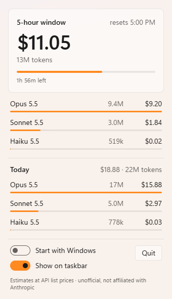

# Juice

A Windows taskbar meter that shows the tokens and estimated cost of your Claude Code sessions, for the current 5-hour window and today.




## Install and run

1. Download `juice.exe` from the [latest release](https://github.com/seifsg/juice/releases/latest).
2. Run it. Windows may warn that the app is unrecognized (the exe is not code-signed): choose **More info → Run anyway**.
3. The taskbar shows the 5-hour window's cost and when it resets, left of the tray (like the weather). With no window running it shows today's cost.
4. Click it for the breakdown per model. The flyout also has **Start with Windows**, **Show on taskbar** and **Quit**.
5. The tray icon shows the same number. Windows 11 puts new tray icons in the overflow (`^`) at first: drag it onto the taskbar to keep it visible.

Running it twice just opens the flyout of the copy already running.

## What it reads

- Claude Code's own session logs: `%USERPROFILE%\.claude\projects\**\*.jsonl`, or `%CLAUDE_CONFIG_DIR%\projects` when that variable is set.
- Nothing else. No network, no account, no API key.
- Each response is counted once, even though the logs repeat it.
- The 5-hour window follows the common rule: it starts at its first response rounded down to the hour and lasts 5 hours. The next response after that opens a new one. "Today" starts at local midnight.
- The taskbar text sits on the main taskbar only, left of the tray. If it ever covers an app button, turn off **Show on taskbar**.
- Juice looks back about a day (26 hours). If you used Claude Code with no 5-hour break for longer than that, its window can start at a different hour than your plan's real one.

## Costs are estimates

- Costs use Anthropic's public API list prices: input, output, cache writes (5-minute and 1-hour), cache reads, fast mode, US-only inference and long-prompt rates.
- A subscription plan bills differently. Treat the number as "what this would cost on the API".
- A model or mode with no published price shows its tokens and "no price". Totals then read `$12.40+`, a lower bound.
- Log lines Juice cannot read are counted and shown, never guessed.

## Build from source

Needs Node 24+, Rust (stable) and Windows 11. Windows 10 should work too (with WebView2 installed, and a solid flyout instead of the Mica backdrop) but is untested.

```bash
npm ci
npm run app
```

The exe lands in `src-tauri/target/release/juice.exe`. Checks: `npm run check`, `npm test`, `cargo test --manifest-path src-tauri/Cargo.toml`. A pushed `v*` tag builds the exe and attaches it to a GitHub Release.

## Unofficial

Juice is an independent project. It is not affiliated with, endorsed by or sponsored by Anthropic. "Claude" and "Claude Code" are Anthropic's trademarks, used here only to say which logs Juice reads.

🏭 Built with [AI Software Factory](https://softwarefactory.company/) by Seif
